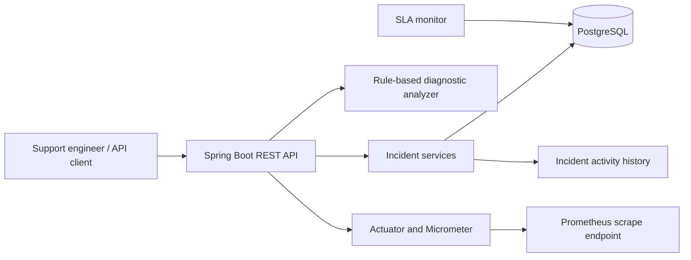
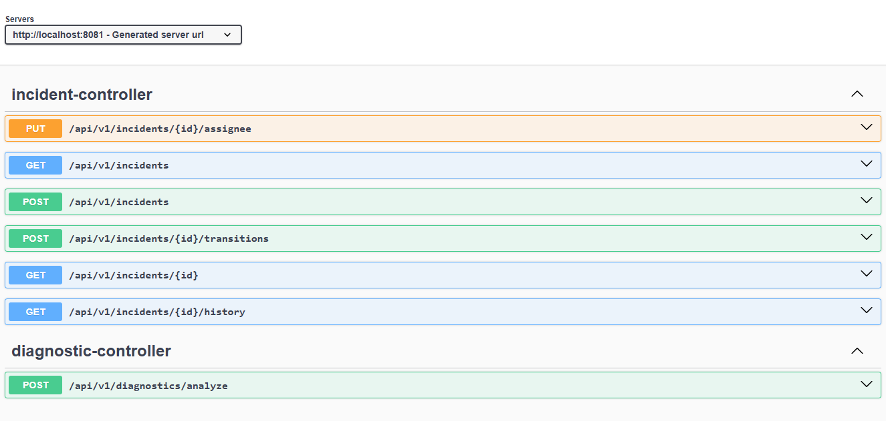
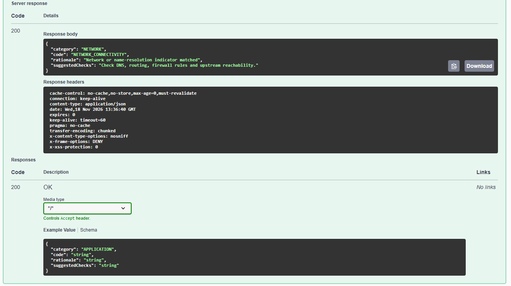
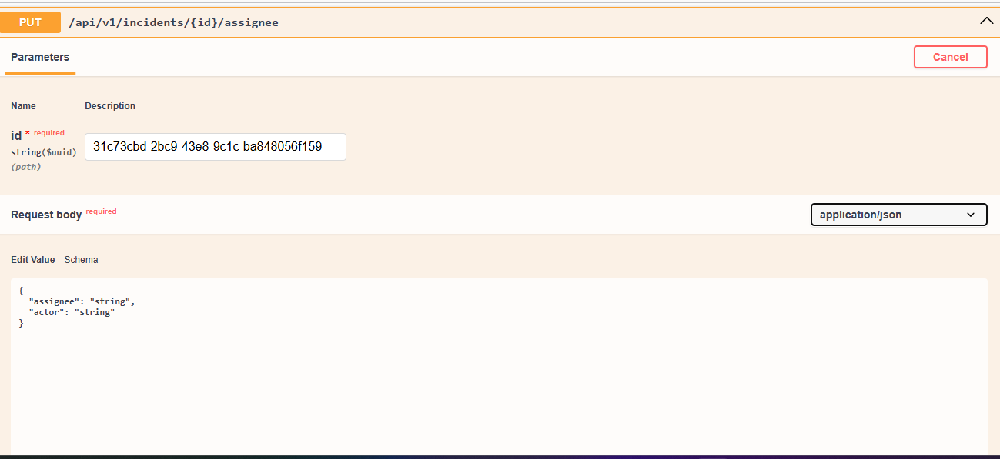

# Production Support Intelligence

A Java-based production support workflow platform for demonstrating incident management, SLA tracking, diagnostic triage and operational observability.

Built with **Java 21, Spring Boot 3.5, PostgreSQL, Flyway, Micrometer and Prometheus**. The project models a practical support-engineering workflow using synthetic incidents and service data.

> **Portfolio project:** uses synthetic data only. It is not affiliated with, or connected to, any employer, customer environment or proprietary support system.

## What it demonstrates

- **Incident management:** create, retrieve, filter and paginate incidents; assign an owner; enforce valid lifecycle transitions.
- **Severity-based SLAs:** calculate response and resolution deadlines for SEV1–SEV4 incidents.
- **Operational history:** record application-managed creation, assignment and status-change activity with actor, detail and timestamp.
- **Diagnostic triage:** classify supplied log excerpts with deterministic, explainable keyword rules and return suggested checks.
- **Observability:** expose health information and SLA breach gauges through Spring Boot Actuator and Prometheus.
- **Persistence and delivery:** PostgreSQL storage, Flyway migrations, Docker Compose and GitHub Actions verification.

## Architecture



## Application screenshots

The following screenshots were captured from the locally running demo application.

### Swagger API documentation



### Diagnostic analysis



### Incident activity history



## Technology

| Area | Technology |
|---|---|
| Language / runtime | Java 21 |
| Application framework | Spring Boot 3.5.7 |
| API | Spring MVC, Bean Validation, OpenAPI |
| Persistence | Spring Data JPA, PostgreSQL 16 |
| Database migrations | Flyway |
| Security | Spring Security, HTTP Basic demo authentication |
| Observability | Actuator, Micrometer, Prometheus registry |
| Tests | JUnit 5, Mockito, H2 test profile |
| Build and delivery | Maven, Docker Compose, GitHub Actions |

## Run locally with Docker

### Requirements
- Docker Desktop (Windows/macOS) or Docker Engine
- Docker Compose v2

Clone the repository and start the stack:

```bash
git clone https://github.com/sajuu730/production-support-intelligence.git
cd production-support-intelligence
docker compose up --build -d
docker compose ps
```

Wait until PostgreSQL is healthy and the application has completed startup.

Default local endpoints:

| Resource | URL |
|---|---|
| API base | http://localhost:8080 |
| Swagger UI | http://localhost:8080/swagger-ui.html |
| Health | http://localhost:8080/actuator/health |
| Prometheus metrics | http://localhost:8080/actuator/prometheus |

If host port **8080** is already in use, change the host side of the app port mapping in `docker-compose.yml` (for example, `8081:8080`) and use that host port in the URLs above.

### Demo credentials and local secrets

The local Compose defaults are `support / change-me-demo` for the demo API account and `local-demo-password` for the local PostgreSQL password. These are **development-only defaults**. Override `APP_SECURITY_USERNAME`, `APP_SECURITY_PASSWORD` and `POSTGRES_PASSWORD` before any exposure beyond a trusted local environment. Do not commit real credentials.

## Try the API

The following PowerShell example creates a synthetic SEV2 incident:

```powershell
$pair = "support:change-me-demo"
$bytes = [System.Text.Encoding]::ASCII.GetBytes($pair)
$token = [Convert]::ToBase64String($bytes)
$headers = @{ Authorization = "Basic $token" }

$body = @{
    title = "Checkout API returning 503"
    description = "Synthetic test incident. Checkout service is returning HTTP 503 errors."
    service = "checkout-api"
    severity = "SEV2"
    category = "APPLICATION"
    reporter = "demo-user"
} | ConvertTo-Json

Invoke-RestMethod -Method Post `
  -Uri "http://localhost:8080/api/v1/incidents" `
  -Headers $headers `
  -ContentType "application/json" `
  -Body $body
```

The API also supports incident listing, retrieval, assignment, lifecycle transitions, activity history and diagnostic analysis. See [docs/api.md](docs/api.md) for request examples and the complete endpoint list. For an end-to-end support-engineer scenario with PowerShell commands and an interview narrative, see the [incident walkthrough](docs/demo-walkthrough.md).

## SLA policy examples

| Severity | Response target | Resolution target |
|---|---:|---:|
| SEV1 | 5 minutes | 4 hours |
| SEV2 | 15 minutes | 8 hours |
| SEV3 | 1 hour | 2 days |
| SEV4 | 4 hours | 5 days |

These are demonstration targets, not contractual service commitments. The current implementation measures elapsed wall-clock time; business calendars, pause accounting and maintenance windows are not implemented.

## Build and test without Docker

Requirements: Java 21 and Maven 3.9 or later.

```bash
mvn --batch-mode test
mvn --batch-mode verify
```

The test profile uses H2. The GitHub Actions workflow runs Maven verification on pushes and pull requests.

## Documentation

- [Architecture](docs/architecture.md)
- [API guide](docs/api.md)
- [Operations guide](docs/operations.md)
- [Demo scenarios and evidence checklist](docs/demo-scenarios.md)
- [End-to-end incident walkthrough](docs/demo-walkthrough.md)
- [Scope and known limitations](docs/limitations.md)

## Scope and engineering boundaries

This is a **portfolio demonstration, not a production-certified ITSM platform**.

- Diagnostic analysis is deterministic keyword-based triage, not AI and not definitive root-cause analysis.
- Authentication is a single in-memory demo account; RBAC, SSO and external identity integration are not implemented.
- Activity history is append-only through application workflows, but is not tamper-proof against direct database changes.
- SLA monitoring uses process-local scheduling; distributed scheduler coordination is not implemented.
- No external ticketing, paging, email, chat, CMDB or log-platform integrations are included.
- High availability, disaster recovery and load testing have not been validated.

See [docs/limitations.md](docs/limitations.md) for the full list and potential next increments.

## License

Released under the [MIT License](LICENSE).
